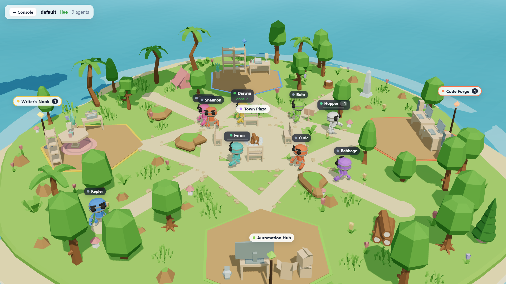

# @agent-viz/server



**Watch your AI agents work as robots in a little 3D world**: an island, an office, a city, a market or a party.
Full guide, screenshots and demo video: **https://github.com/gideonabe/agent-world**

```bash
npx @agent-viz/server --mock --memory   # then open http://127.0.0.1:8787
```

The authoritative hub. It keeps every project's world state, accepts events over HTTP or WebSocket, and streams
changes to viewers.

## Running

```bash
npm run server:empty                 # local dev: no keys, localhost only, state saved in ./.agent-world-data
npm run server                       # same, plus the simulator in the "default" project (memory only)
npm run server:auth                  # API keys required; prints an admin token once on first start
npm run aw -- --auth --host 0.0.0.0  # serve on your network (auth is required for non-localhost hosts)
```

Flags: `--port`, `--host`, `--data <dir>`, `--memory`, `--auth`, `--insecure`, `--mock [project]`, `--world <id>` (world for new projects).

## Projects and keys

Each project is its own island, with its own agents, keys and viewers.

| Key | Prefix | Can |
|---|---|---|
| Write key | `aww_` | Send events, watch, and send commands from a viewer |
| Read key | `awr_` | Watch only (snapshot and WebSocket) |
| Admin token | `awadm_` | Manage projects and keys (and everything else) |

Keys are stored as SHA-256 hashes, and each full key is shown exactly once, when it's created.

### From the CLI (works while the server runs)

```bash
npm run aw -- projects create my-app --name "My App" --world city
npm run aw -- projects set-world my-app party        # a running server picks this up on restart; switch live from the console or PATCH
npm run aw -- worlds                                 # meadow-island, office, city, market, party
npm run aw -- keys create --project my-app --role write --name ci
npm run aw -- keys create --project my-app --role read --name dashboard
npm run aw -- keys list --project my-app
npm run aw -- keys revoke key_AbC123
npm run aw -- admin-token reset
```

### Over HTTP (with the admin token)

| Method | Path | Who |
|---|---|---|
| GET | `/health` | Anyone |
| GET | `/v1/worlds` | Anyone (the worlds projects can use) |
| GET, POST | `/v1/projects` | Admin (POST takes `{ id, name?, worldId? }`) |
| GET, DELETE | `/v1/projects/:id` | Read key / admin |
| PATCH | `/v1/projects/:id` | Admin: `{ name?, worldId? }`; changing the world moves everyone watching to it, live |
| POST | `/v1/projects/:id/events` | Write key |
| GET | `/v1/projects/:id/snapshot` | Read key |
| WS | `/v1/projects/:id/ws?token=…` | Read key (sending commands needs a write key) |
| GET, POST | `/v1/projects/:id/keys` | Admin |
| DELETE | `/v1/projects/:id/keys/:keyId` | Admin |

Auth is sent as `Authorization: Bearer <key>`, as `x-api-key`, or as `?token=` (for WebSockets). The old paths
`/events`, `/snapshot` and `/ws` still work, and map to the `default` project.

## Behaviour

- **Persistence.** The registry and each project's state are written atomically to the data dir, debounced to
  every 2 s, and also on shutdown. Restarting restores everything.
- **Rate limiting.** Each key gets a token bucket of 500 events/s with a burst of 2000. Over the limit, HTTP returns
  `429` and the WebSocket returns an `error` frame.
- **WebSocket auth failures** close with code `4401` or `4403`, and the viewer client stops retrying.
- **Dev mode** (`--auth` off) auto-creates projects on first use and refuses non-loopback hosts unless `--insecure`.
